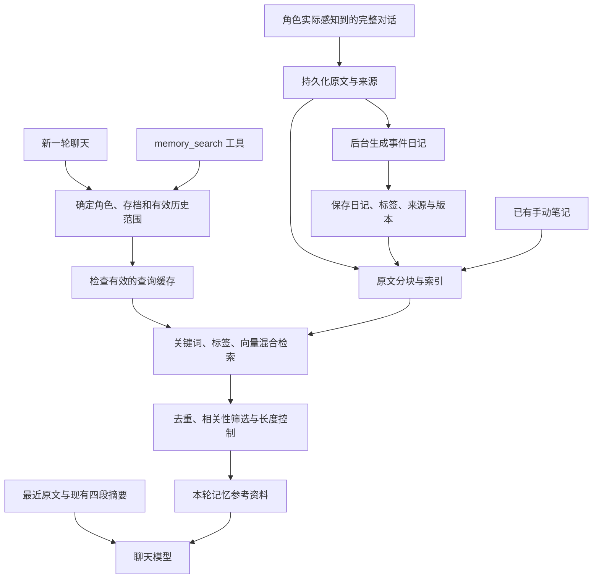

# 聊天长期记忆 RAG、事件日记与缓存构建计划

日期：2026-10-18。状态：P0–P5 已完成，下一阶段为 P6；混合检索、两层 LRU、聊天自动回忆与搜索工具已接入，自动日记生成待 P6。实测结果见 [P0 验收记录](memory-rag-p0.md)、[P1 验收记录](memory-rag-p1.md)、[P2 验收记录](memory-rag-p2.md)、[P3 验收记录](memory-rag-p3.md)、[P4 验收记录](memory-rag-p4.md) 与 [P5 验收记录](memory-rag-p5.md)。P5 已通过宿主测试与真实模型检索，远程聊天模型和桌面界面的实聊验收仍待 P7；当前检索要求绑定存档，未落盘的历史在保存后参与检索。

dev 适配：已对齐 `upstream/dev` 的模型引擎迁移与笔记语义检索；模型引擎位于 notes，共享同一实例。上游 `retrieval` 继续负责笔记向量检索，长期记忆混合检索位于 `memory_retrieval`。适配记录见 [dev 适配与验证](memory-rag-dev-adaptation.md)。

复审修复：P0–P2 的来源判定、删除清理、模型恢复与分块性能修复见 [P0–P2 复审记录](memory-rag-p012-review.md)。P3–P4 的日期解析、日期候选筛选顺序及事实去重修复见 [P3–P4 复审记录](memory-rag-p34-review.md)，检索版本已升为 `hybrid-rrf-v2`。

## 1. 目标和主要思路

让角色在保持最近对话与既有摘要的同时，能够找回自己曾经感知到的相关经历。长对话被整理成有原文来源的事件日记；日记、笔记和历史原文通过关键词、标签、向量混合检索进入当前回复。缓存减少重复计算，LRU 限制缓存占用。

核心原则：先确定角色能知道哪些内容，再判断哪些内容与本轮相关；先保证来源、版本和存档一致，再优化速度。日记是历史的整理产物，原始台词仍是历史事实的主要来源。检索结果只作为参考资料，不改写角色设定，也不作为当前指令执行。

缓存命中并通过范围、版本校验时可直接复用候选；图中检索步骤只在需要时执行。

## 2. 已核实的基础与缺项

| 项目         | 当前情况                                                     | 本次处理                             |
| ------------ | ------------------------------------------------------------ | ------------------------------------ |
| 聊天历史     | SQLite 台词、感知关系、存档历史链已经存在                    | 复用，按有效历史链取数               |
| 自动记忆     | 已有近期摘要、长期经历、用户资料、约定四段压缩               | 保留，独立接入日记和检索             |
| 手动笔记     | `ling-chat-notes` 按角色 JSON 存储，已有 tags 和增删改查     | 兼容原文件与工具，加入检索           |
| 向量引擎     | notes 内已有共享 EmbeddingEngine，Tool RAG 与笔记检索使用它  | 复用同一实例                         |
| 模型资源     | P0 已下载 bge-small-zh-v1.5 uint8 资源，并通过真实 ONNX 推理 | 复用现有中文模型，文件快照见 P0 记录 |
| Tool RAG     | 已有工具检索与按角色激活缓存                                 | 复用工具发现链路，新增记忆搜索工具   |
| 事件日记     | 尚无完整机制                                                 | 新增有来源、可失效、可重试的后台生成 |
| 长期记忆检索 | 尚无完整链路                                                 | 新增分块、索引、混合检索、注入、缓存 |

前序检查结果：main 业务 crate 的离线 cargo check 通过；相关测试 59 项通过、0 失败、1 项真实模型测试跳过；开发数据库 quick_check 为 ok。这些是实施前基线，不代表新功能或完整应用已经通过验收。开发数据库仅有 6 条台词，质量评估需另建样例。

P0 复核结果：main 离线 cargo check 通过；既有相关回归 59 项通过；新增隔离数据库检查 3 项通过；单独运行真实模型测试 1 项通过。已准备 16 份候选文档与 18 条标注查询，测试仅写入临时目录。混合检索质量、日记生成与缓存失效将在对应后续阶段验收。

P1 复核结果：已在 notes 定义文档、来源、范围、分块、结果与版本契约；main 提供有效历史和角色感知快照、完整工具事务来源与候选范围校验。旧笔记保持角色级跨存档语义。相关测试合计 80 项通过、0 失败，main / notes 离线编译检查通过。该结果验证来源资格和版本一致性，尚未验证实际检索命中率。

P2 复核结果：已实现四张 SQLite 派生索引表、实际 token 计数与无损分块、原文／笔记增量同步、持久化向量复用和强制重建；事务回滚、来源失效与并发旧任务保护通过。相关测试合计 96 项通过、0 失败，main / notes 离线编译检查通过。真实模型生成 2 个文档、4 个分块，重开数据库后复用全部 4 个向量。尚未接入聊天回忆或验证混合检索质量。

## 3. 第一版范围和默认选择

- 记忆来源包括历史原文分块、事件日记和已有手动笔记；四段自动摘要继续承担当前的连续性职责，不再复制成另一份可变事实库。
- 日记先做“按完整对话段整理的事件日记”。第一版记录可证实的经历、计划和明确表达的感受，保留状态区别；不要求每天定时生成或文学化扩写。
- 第一版采用本地模型、SQLite、进程内检索；向量归一化后用余弦相似度精确搜索，无需先部署外部向量数据库。
- 回复前自动检索作为默认路径；新增 `memory_search` 工具支持主动追问和精细回忆，两者调用同一服务。
- 新自动记忆默认按存档和角色隔离。现有手动笔记维持原有跨存档语义，明确标识为角色级笔记，不擅自改变旧数据含义。
- 首版提供可检查的记忆检索调试信息。独立日记浏览编辑页面、定时写作、云同步新协议、更大向量模型和神经网络重排留作后续需求。

以上是根据现有信息确定的实施默认值；后续协作补充需求时更新本文件，不将推测当作已有约定。

## 4. 模块分工

| 位置                      | 负责内容                                                                                                                                           |
| ------------------------- | -------------------------------------------------------------------------------------------------------------------------------------------------- |
| `crates/ling-chat-notes`  | 记忆文档、分块、标签和检索结果的数据结构；共享向量引擎、笔记向量检索、文本预处理、关键词检索、混合排序与去重；继续维护现有笔记文件读写             |
| `crates/ling-chat-main`   | 从有效历史与感知关系提取素材；日记后台任务及 LLM 调用；SQLite 迁移与读写；向量引擎适配、LRU 缓存；范围校验、历史失效和聊天注入；记忆工具与调试接口 |
| `src-tauri/src/app/setup` | 创建和注入共享服务，不放记忆业务实现                                                                                                               |

依赖方向保持 `main → notes`。notes 不依赖 main、AppState 或 Tauri。main 提供经过范围校验的候选与向量；必要时在 notes 定义一个小接口，由 main 适配现有引擎，不为共用模型建立循环依赖。

新 SQLite 表由 main 的既有迁移系统管理，notes 通过普通数据结构使用它们。这样主要检索能力在 notes crate，宿主数据库和聊天状态仍留在 main。第一版不为此大规模搬迁已有 Tool RAG 或重构全部记忆系统。

## 5. 数据、日记和历史一致性

### 数据来源与持久化

- 原始聊天继续保存在既有 SQLite 台词表；检索不删除、替代或改写原始历史。
- 事件日记正文与分块、来源关联、向量和处理进度存入 SQLite 新表，使用既有事务和迁移机制。建议按“文档、分块、来源关联、向量、归档任务进度”划分必要记录，实施时按实际查询合并简单结构。
- 现有手动笔记 JSON 仍是笔记的权威来源。索引只保存其检索副本，按笔记 ID 和内容版本更新，启动或首次使用时核对文件内容，兼容外部编辑。
- 每份文档至少记录 ID、类型、角色、适用范围、内容、标签、时间、版本和来源。对话派生内容必须关联具体源台词，不能只记录一个会随撤回变化的数组下标。
- 区分实际记录时间、对话中明确提到的事件时间、计划状态和假设；不知道日期时不编造。用户自述保留“用户提到”的属性，角色扮演经历不自动变为现实用户资料。
- 分块记录所属文档、顺序、原文来源和内容摘要哈希；向量记录模型标识、维度、预处理版本。换模型或改分块算法后旧索引可识别、可重建。

### 日记生成规则

1. 沿用现有完整回合与工具事务边界识别，从已持久化、角色可见的历史段生成任务；未保存台词先等待取得稳定 ID。
2. 首版在归档／压缩阶段发现完整旧对话段并登记任务。后台日记任务独立于四段摘要的成功与否，避免额外请求拖住普通聊天。
3. 日记以“来源区间 + 角色 + 内容版本”防重；已登记任务可恢复，完成记录原子提交，重启、失败重试不能重复写同一经历。
4. 输出有明确字段的事件摘要、标签和来源信息，校验后才写入。状态至少区分已经发生、未来计划、假设；只记录有原文依据的感受，不补写心理活动。
5. 日记失败不推进其成功检查点，不阻止现有摘要机制工作；原文可检索，任务按冷却策略重试，避免每轮重复请求。
6. 后台提交前重新检查历史版本和来源有效性。撤回或读档后返回的旧结果必须丢弃。

### 范围与生命周期

- 取有效历史必须沿用存档最后一条台词和父链重建语义；不能把同一 save_id 下的所有行直接当成当前历史。
- 自动记忆要求来源全部仍位于当前有效历史且该角色可感知。部分来源失效的日记整体停用并重新生成，不能保留混有撤回事实的摘要。
- 编辑、撤回、清空、感知关系变更和读档立即让相应旧索引／缓存不可用于当前请求；物理清理可以后台做。
- 存档复制要映射来源到新台词，或从新历史重建。不同分支不得通过复制日记或共享缓存互相泄漏。删除存档清理派生数据，不删除其他存档或角色级手动笔记。
- 保留现有手动笔记工具的显式跨角色只读行为，不把这项能力扩散为普通自动回忆权限。自动回忆默认只读当前角色自己的笔记。
- 所有请求携带角色、存档和历史版本快照，异步检索和最终发送前复核；发生切换时丢弃旧结果并取消或重新构建请求，不能只靠入队时检查。

## 6. 检索方法

1. **限定范围**：取得当前有效历史、角色感知范围和允许访问的笔记集合，先排除无权使用和已失效内容。
2. **生成查询**：优先使用本轮原始输入，附带少量最近对话帮助解析“那件事”等指代。第一版不额外调用 LLM 改写查询；无用户输入的通知路径默认不自动搜，工具调用可显式传 query。
3. **关键词候选**：规范化大小写与空白，保留完整人名、日期和英文词；中文采用连续双字片段辅助覆盖率评分，并提升完整短语命中。该实现属于轻量词法检索，不宣称具备成熟中文分词或 BM25 效果；用验收样例决定是否需要替换。
4. **标签候选**：统一标签格式，按明确命中的标签产生候选或加分。标签是辅助分类，不要求每条记忆必须命中标签，也不用它代替角色权限。
5. **向量候选**：复用共享 bge-small-zh-v1.5 引擎；按模型 tokenizer 的实际 token 数分块，为特殊 token 和查询前缀留余量，避免超过目前 512 token 上限而静默丢掉内容。超长原文保留完整文本，切分时优先句子和完整回合边界；检索文本不拆成不完整工具事务。
6. **合并排序**：关键词、标签、向量各取候选，采用 RRF（按各路排名融合）作为起点，避免直接相加不同量纲的分数。按来源和内容去重，控制同一日记占用的名额。
7. **筛选与注入**：融合排名不等于可信度。按词法有效命中／经样例校准的向量相关性排除弱结果；无关问题允许返回空结果。去掉与最近上下文明显重复的片段，按条数和长度预算输出。

起始参数建议：每路最多 20 个候选，最终最多 5 个片段，参考正文总量先限制为 1800 个 Unicode 字符并预留标题与来源开销；若聊天模型已有 tokenizer 再增加准确 token 上限，不能把字符数宣称为 token 数。参数、阈值和时效加分均需用验收集校准。

只在本轮请求副本中附加“历史记忆参考资料”，标注时间、来源和记忆类型，不回写为新的用户消息或历史事实。系统／角色规则优先，记忆正文中的要求不能当成当前指令。检索超时、模型缺失时降级到关键词／标签；全部失败时继续使用既有最近上下文和摘要。

## 7. 缓存与 LRU

| 对象         | 存储与用途                                           | 作废条件                         |
| ------------ | ---------------------------------------------------- | -------------------------------- |
| 文档向量     | SQLite 持久化派生索引，避免重启后重复推理            | 正文、预处理、模型标识变化       |
| 查询向量缓存 | 进程内有界 LRU，避免相同文本重复推理                 | 模型或预处理版本变化             |
| 检索结果缓存 | 进程内有界 LRU，保存候选 ID 和版本，减少相同查询搜索 | 历史、文档、可见性或检索参数变化 |

持久化向量是索引，不靠 LRU 淘汰；LRU 只移出临时副本，不能删除笔记、日记或原始聊天。

查询向量键为“模型版本 + 规范化后的完整查询”；结果键至少包含“存档 + 角色 + 历史版本 + 索引／笔记版本 + 查询及近期语境哈希 + 检索参数版本”。第一版只做相同查询语境的复用，不用向量相似度把两个不同问题直接视为缓存命中。

初始容量可设为查询向量 128 项、结果 64 项，同时限制单项查询长度与候选数量。实际命中或插入时更新最近使用顺序；满时移出最久未使用项。不仅按项数，还记录内存占用，避免巨型查询绕过容量控制。无需先引入独立缓存服务。

命中后仍复核文档存在、版本和访问范围，不能把“缓存有”视为“可以给当前角色”。TTL 仅作容量辅助，不能替代版本失效。新历史版本不复用旧结果，但可复用相同文本的查询向量。

## 8. Tool RAG 联动

- 在 main 的既有 ToolRegistry 注册 `memory_search`，支持 query，必要时提供受限的结果数与记忆类型参数。
- 存档、当前角色和访问权限由宿主上下文决定，不能由工具参数任意指定；返回文本、来源、时间和类型，附带受控的相关性说明。
- Tool RAG 负责发现该工具；记忆服务负责搜索内容。复用现有工具执行器的参数校验、超时、权限和活动事件，不为记忆再写一套工具循环。
- 自动检索和工具搜索共用范围校验、索引、排序与缓存，避免两份逻辑给出不同权限结果；同一来源在上下文里去重。
- 模型缺失时记忆工具返回词法结果或明确的无结果，不编造“已经想起”。现有 Tool RAG 的降级行为继续适用。

## 9. 分阶段任务清单

| 阶段                   | 任务与产物                                                                                           | 进入下一阶段的验收条件                                                                         |
| ---------------------- | ---------------------------------------------------------------------------------------------------- | ---------------------------------------------------------------------------------------------- |
| P0：基线与模型         | 下载模型；真实嵌入测试；记录当前摘要和工具行为；建立专用测试数据库与验收样例                         | 实际模型输出维度、归一化和语义区分验证通过；不改用户数据库做测试                               |
| P1：范围与数据契约     | 在 notes 定义文档／来源／分块／结果类型；实现有效历史与感知范围提取；确定旧笔记兼容策略和版本键      | 多角色、分支、撤回与旧 JSON 读取样例通过；范围限制先于相似度排序                               |
| P2：持久化与原文索引   | SQLite 迁移；文档分块与向量存储；手动笔记索引同步；幂等增量更新和重建入口                            | 重启可复用索引；正文修改只更新受影响内容；换模型可识别重建；失败不破坏原文                     |
| P3：混合检索           | notes 内实现关键词、tag、向量融合、弱结果过滤、去重和预算；main 适配共享引擎                         | 明确词语、同义改述、指代、无关输入均有可解释结果；跨角色／存档结果为零                         |
| P4：缓存与 LRU         | 接入查询向量和检索结果缓存；容量边界、命中统计、版本校验和失效处理                                   | 重复请求减少实际工作；触碰更新顺序正确；修改／读档立即失效；淘汰后永久记忆仍在                 |
| P5：聊天与工具接入     | 回复前自动检索；注册 memory_search；接入 Tool RAG；历史资料注入；调试快照与开关                      | 角色能引用窗口外旧事实；不会把检索片段写回原始历史；关闭／超时可正常聊天；切换期间不发送旧结果 |
| P6：事件日记联动       | 后台任务、结构化日记生成、来源和版本检查、幂等进度、重试恢复；日记建立索引                           | 完整旧回合可生成并检索日记；计划与事实分开；失败可恢复；旧任务不能污染新历史；重复来源去重     |
| P7：生命周期与发布验收 | 完整检查编辑、撤回、读档、复制、删除、外部笔记修改与模型切换；质量和性能评估；资源打包／同步策略说明 | 验收矩阵通过；恢复旧存档正常；模型资源可打包；缓存与派生索引的同步／重建策略明确               |

执行顺序：P0 → P1 → P2 → P3 → P4 → P5 → P6 → P7。P1/P2 就要预留日记类型和来源关系，P6 再接入真实日记生成，避免中途推翻数据结构。生命周期基础检查分布在每阶段，P7 做完整集成复核。

- [x] P0 基线与真实模型验证（见 [验收记录](memory-rag-p0.md)）
- [x] P1 范围、来源和数据契约（见 [验收记录](memory-rag-p1.md)）
- [x] P2 持久化、分块与索引（见 [验收记录](memory-rag-p2.md)）
- [x] P3 关键词／tag／向量混合检索（见 [验收记录](memory-rag-p3.md)）
- [x] P4 缓存与 LRU（见 [验收记录](memory-rag-p4.md)）
- [x] P5 自动回忆与记忆搜索工具
- [ ] P6 事件日记联动
- [ ] P7 生命周期、质量与发布验收

## 10. 验收样例与检查方法

| 场景                                 | 预期结果                                         |
| ------------------------------------ | ------------------------------------------------ |
| 超出最近窗口的独有旧事实             | 问题不包含答案，仍能在前 5 个结果找到正确来源    |
| 同义改述、名字、日期和标签查询       | 分别验证向量、词法和标签的实际贡献               |
| 连续追问“那次呢”                     | 能使用有限近期语境区分对象，不把无关缓存直接复用 |
| 两个角色、两个存档、分支与未感知事件 | 自动回忆不返回范围外内容，缓存命中也不能越界     |
| “计划去海边”与“已去海边”             | 日记和回答保留时态区别，不凭计划补写经历         |
| 撤回／修改源对话后再次提问           | 旧日记、旧索引和旧缓存均不能再作为有效记忆返回   |
| 日记请求期间切换存档／重启／失败重试 | 无错误提交、无重复归档、检查点可恢复             |
| 更新／删除／外部编辑手动笔记         | 检索及时反映变化，旧格式和既有工具仍可用         |
| 模型缺失、推理失败、无关问题         | 有明确降级或空结果；不阻断聊天，不硬塞最高分噪声 |
| 多次引用同一事件                     | 原文、日记、笔记的重复片段受控，不占满上下文     |
| 缓存触碰与满容量                     | 移出最久未使用项；重新检索仍能找回永久数据       |

固定验收集至少覆盖上述各类。对每条查询标注正确来源和应排除来源；首版暂定有答案样例 hit@5 不低于 90%，隔离／失效等确定性用例必须全部通过，并单独统计无关查询误召回。先在小集合调参，再用未参与调参的样例复核；实际指标和失败例必须记录，不能把目标写成已达成结果。

性能使用合成／脱敏的 200、2000、10000 分块规模，记录冷／热检索延迟、向量调用次数、缓存命中率、内存、索引磁盘占用，以及日记生成耗时／LLM 请求数。基线测量后确定超时与容量，不提前承诺具体毫秒数。真实 ONNX 推理必须放入阻塞线程池；生成日记、扫描索引和推理期间不持有全局游戏状态锁。

实施验证按改动范围运行 notes 单元测试、main 相关回归测试和真实模型测试；交付时运行工作区编译／测试，涉及前端时运行 `pnpm build`，涉及资源时验证桌面打包路径。只做本文档规划时不宣称上述新功能测试已通过。

## 11. 里程碑与后续扩展

- 里程碑一（P0–P3）：能从正确范围的旧原文和笔记中找到相关记忆，支持重启后继续检索。
- 里程碑二（P4–P5）：聊天实际使用检索结果，主动工具回忆可用，缓存有效且不会带入旧版本。
- 里程碑三（P6–P7）：日记自动生成并参与回忆，读档／撤回／重启等流程完整通过验收。

第一版完成后，再根据实测决定是否增加成熟中文全文检索、向量近似索引、精排模型、每日合并日记和可视化日记管理。不能只凭“记忆多了可能慢”就提前引入额外服务。

## 12. 实施参考入口

- `crates/ling-chat-notes/src/lib.rs`：现有 Note、NotesStore 与 JSON 兼容入口。
- `crates/ling-chat-notes/src/memory.rs`：记忆文档、来源、分块、结果及版本契约。
- `crates/ling-chat-notes/src/chunking.rs`：实际 token 预算与保留完整来源的文本分块。
- `crates/ling-chat-notes/src/memory_retrieval.rs`：关键词／标签／向量三路候选、RRF、相关性过滤、去重与字符预算。
- `crates/ling-chat-main/src/ai_service/game_system/memory_scope.rs`：素材快照、角色／存档范围与来源版本校验。
- `crates/ling-chat-main/src/ai_service/game_system/memory_index.rs`：原文／笔记索引同步、向量复用与重建入口。
- `crates/ling-chat-main/src/ai_service/game_system/memory_search.rs`：当前范围的混合检索、查询向量降级与返回前版本复核。
- `crates/ling-chat-main/src/ai_service/game_system/memory_cache.rs`：查询向量与候选结果的有界 LRU、字节预算、命中统计与清空入口。
- `crates/ling-chat-main/src/ai_service/game_system/memory_recall.rs`：自动／工具共用的宿主服务、当轮预算、来源复核、临时资料与超时降级。
- `crates/ling-chat-main/src/ai_service/tools/memory_search.rs`：受当前角色与存档范围限制的记忆搜索工具。
- `crates/ling-chat-main/src/db/managers/memory_index_repo.rs`：持久化索引读取、事务提交与并发版本保护。
- `crates/ling-chat-main/src/ai_service/embedding/`：共享向量引擎。
- `crates/ling-chat-main/src/ai_service/tools/tool_rag.rs`、`tool_search.rs`、`memory.rs`：工具发现和既有记忆工具。
- `crates/ling-chat-main/src/ai_service/game_system/persistent_memory_system.rs`：四段摘要、完整回合边界和后台版本保护。
- `crates/ling-chat-main/src/ai_service/game_system/memory_builder.rs`：角色感知过滤规则。
- `crates/ling-chat-main/src/ai_service/message_system/generator.rs`：请求副本与记忆注入接入点。
- `crates/ling-chat-main/src/db/managers/save_repo.rs`：有效历史链、存档同步和来源 ID。
- `docs/persistent-memory-compression.md`、`docs/function_call/memory.md`、`docs/function_call/tool_rag.md`：既有行为约定。
