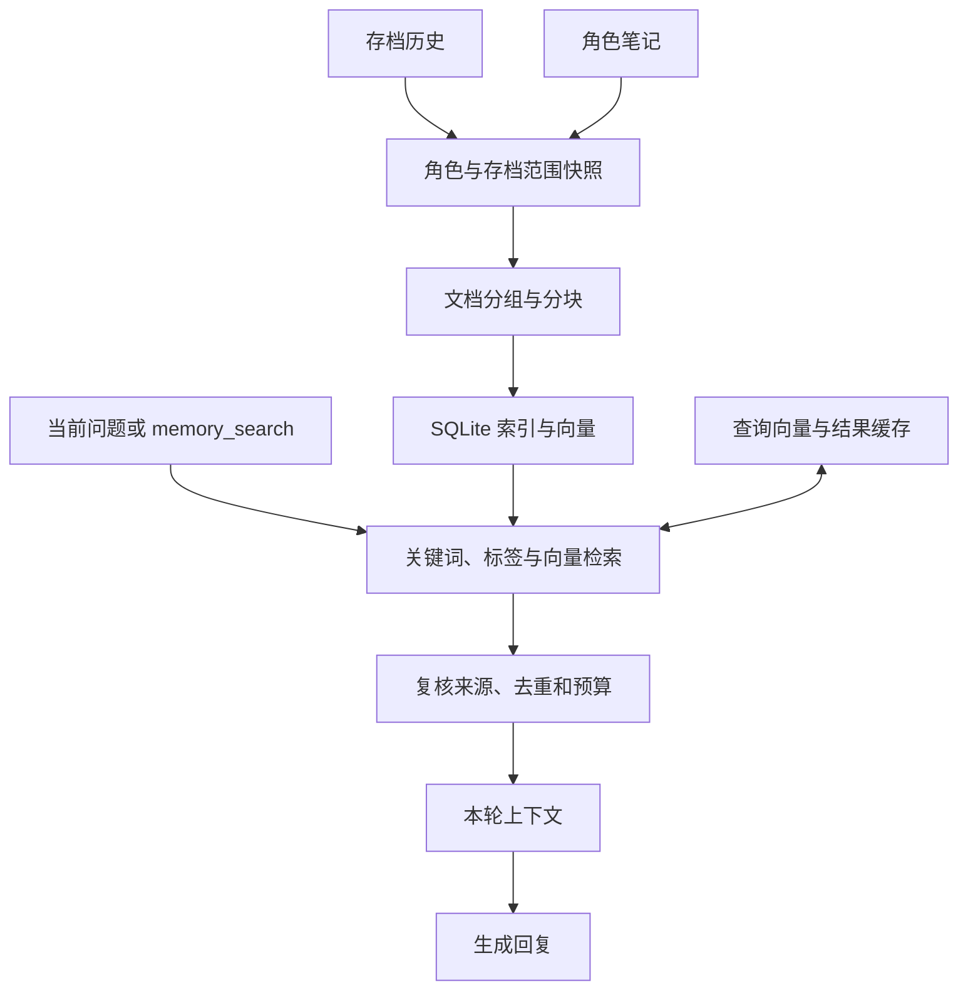

# 聊天记忆与检索设计

## 目标与边界

角色的对话上下文由人设、近期可见台词和可选的永久记忆摘要组成。随着聊天增长，摘要能保留主要经历，但可能遗漏具体细节。记忆检索在当前问题需要时，从当前存档中该角色可见的历史及角色笔记里找相关片段，作为本轮回答的参考。

检索索引是可重建的派生数据：聊天台词及存档是历史来源，角色笔记文件是笔记来源。检索不替代现有摘要或近期上下文，也不会把检索结果再作为新经历保存。永久记忆的压缩调度见 [永久记忆压缩调度](persistent-memory-compression.md)；原有笔记工具的独立向量检索见 [笔记语义检索](notes-retrieval.md)。

举个例子：玩家问“上次约好去哪里”，近期对话和摘要先帮助角色理解当前话题；检索再尝试找出与约定相关的旧台词或笔记。如果找不到，角色仍然可以正常回复，但不应该把猜测当成确实发生过的事。

## 模块与数据流

主要代码位于 `crates/ling-chat-main/src/ai_service/game_system/memory/`，由 `mod.rs` 导出：

- `builder` 从角色可见台词构造对话消息，`persistent` 负责已有的摘要压缩。
- `scope` 按角色和存档生成来源快照；`index` 维护增量索引。
- `search` 执行检索及来源复核；`cache` 管理缓存；`recall` 管理单轮会话和引用预算。

`ling-chat-notes` 提供记忆数据结构、分块和混合排序；主程序负责访问存档、权限和数据库。`db/managers/memory_index_repo.rs` 负责索引读写，自动回忆从消息生成器进入，`memory_search` 工具通过相同的 `MemoryRecall` 服务检索。

## 来源和索引

检索范围由宿主确定为当前角色和活动存档，模型不能通过工具参数指定其他角色或存档。历史沿存档有效链读取，再按角色感知权限筛选；笔记按宿主解析的角色展示名读取。完整工具调用和结果需要配对且均可见，孤立或不完整的工具结果不进入索引。

可见历史按对话轮次组织成文档，笔记各自成为文档，再按模型 token 上限分块。含工具事务的文档保持整体；过长或向量化失败时保留词法检索。`memory_document`、`memory_chunk`、`memory_embedding` 和 `memory_index_state` 分别保存文档、分块、向量及角色与存档的索引状态。

每次需要检索时，服务先对照来源版本同步索引：未变化且分块、向量完整的文档直接复用；新增或变化的内容重新分块和计算。模型及分词器指纹、分块策略和内容版本参与复用判断。索引计算在阻塞线程中进行，提交前再次核对来源和索引代数，避免较慢的旧任务覆盖新结果；角色或存档删除时清理对应索引。

当前记忆索引使用本地 `bge-small-zh-v1.5` 量化模型，与工具／笔记检索共享本地模型实例；上游新增的云端向量路由尚未接入记忆索引。模型不可用时索引可保留词法内容，向量路线不可用。

## 检索与缓存

查询分别生成关键词、标签和向量候选，通过倒数排名融合（RRF）排序，再按相关性阈值、来源和预算过滤。短问句包含“那次”等指代时可补充近期上下文；对可解析的日期查询使用时间信息筛选。自动回忆和工具检索共用单轮去重及预算，默认最多引用 5 条、1800 字符，同一文档默认最多 2 条。

这三条路线各有作用：关键词适合找明确的人名和物品，标签补充笔记里已有的分类，向量负责寻找措辞不同但意思接近的内容。融合后仍要经过阈值过滤，避免把每次搜索都强行凑满结果。

两层内存 LRU 分别缓存查询向量和检索结果：默认上限为 128／64 条、各 1 MiB，单条最多 32 KiB。结果缓存键包含角色、存档、历史及笔记版本、索引和检索参数；查询向量缓存绑定模型与查询。即使命中缓存，返回前仍重新读取范围并复核来源。临时分词或推理失败不缓存结果，后续可重试。

## 会话与失败处理

自动回忆在构建当前角色上下文后进行；`memory_search` 可在工具循环中按需调用，接受 `query`、可选 `max_hits` 和 `kinds`，权限仍由工具权限配置决定。自动回忆和工具共享来源快照、去重与引用预算。检索资料附在本轮请求中，作为历史数据而非指令；工具调用配对保留，持久化结果正文替换为临时标记。

会话快照包含存档、角色、玩家身份、历史与生成版本。检索返回、工具执行、回复落地和发布等环节会复核相关状态；修改笔记时撤销旧引用并重建上下文。请求没有活动存档、检索关闭、繁忙、超时或失败时，不阻塞普通聊天。默认等待 2 秒，配置限制在 100–10000 毫秒；超时后后台任务仍占用唯一许可直到结束，避免推理任务持续堆积。

例如模型查到了旧笔记，随后又在同一轮修改这篇笔记，后续请求会从基础上下文重新构建，避免继续使用修改前的正文。切换角色或存档时也会重新检查所属范围，已经过期的回复不能继续发布到新会话。

`diary` 类型保留在数据契约中，当前没有接入自动日记生成与联动。桌面实际聊天、不同模型的召回效果及大规模索引性能仍需结合真实使用验证。
